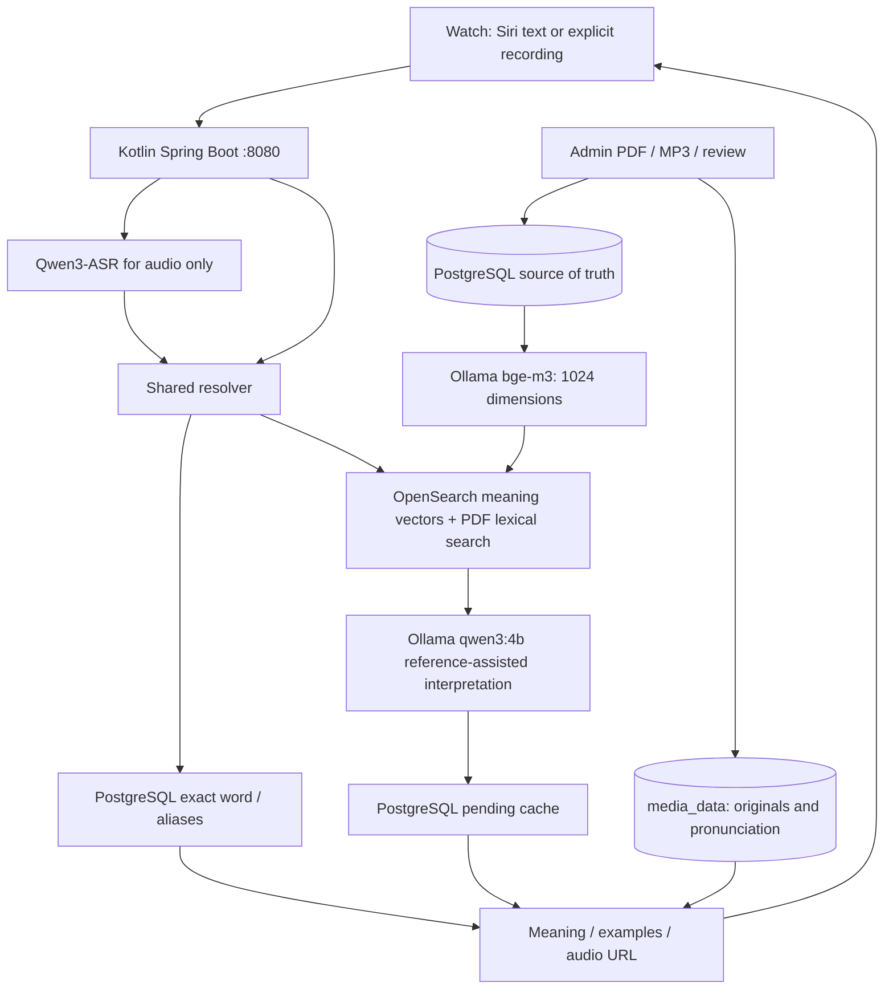

# TalkieVoca Backend

Kotlin + Spring Boot backend for the TalkieVoca Apple Watch app. PostgreSQL owns vocabulary and provenance, OpenSearch retrieves uploaded knowledge, Ollama supplies missing vocabulary cards, and Qwen3-ASR is the optional high-accuracy speech provider.

## Run

```bash
brew services start ollama
ollama pull qwen3:4b
ollama pull bge-m3
docker compose up --build
```

The default Compose setup runs PostgreSQL, OpenSearch, the Kotlin API, and a pinned ARM64-capable Qwen3-ASR CPU image. A small TalkieVoca adapter loads only Qwen3-ASR-0.6B through the image's Rust backend. The stack reaches Ollama on the Mac through `host.docker.internal`. Known words never call the text model.

The first Qwen start downloads the model into a named Docker volume and can take several minutes. Later starts reuse the cache. The API remains available for text lookup while ASR reports `unavailable` during warm-up.

## Verify

```bash
curl http://localhost:8080/health
curl 'http://localhost:8080/v1/watch/word-feedback?word=apple'
curl 'http://localhost:8080/v1/watch/word-feedback?word=unknown'
curl -X POST http://localhost:8080/v1/assistant/query \
  -H 'Content-Type: application/json' \
  -d '{"text":"사과"}'
curl -F 'file=@src/main/resources/static/audio/apple.m4a' http://localhost:8080/v1/assistant/audio
```

`/health` reports `asr` and `slm` as `ready`, `disabled`, or `unavailable`.

## Qwen3-ASR

Local development uses `quantatrisk/qwen3-asr:cpu-latest` pinned by digest. `docker/qwen-asr-server.py` exposes only the OpenAI-compatible endpoints TalkieVoca needs, converts short uploads to mono 16 kHz WAV, and serializes inference through the image's Qwen Rust engine. It does not load the provider's Chinese realtime, speaker diarization, or forced-alignment models. Raw Watch recordings live only in an automatically removed temporary directory.

For production, replace the local endpoint with an official CUDA/vLLM Qwen3-ASR service using the same OpenAI-compatible contract:

```bash
export TALKIEVOCA_ASR_ENABLED=true
export TALKIEVOCA_ASR_URL=https://your-qwen-asr-server
export TALKIEVOCA_ASR_MODEL=Qwen/Qwen3-ASR-0.6B
export TALKIEVOCA_ASR_API_KEY=replace-with-your-secret
docker compose up --build -d
curl http://localhost:8080/health
```

Do not commit the API key. Set `TALKIEVOCA_ASR_ENABLED=false` to run without Qwen; Siri/native dictation and text lookup continue to work. The Docker model cache is `qwen_asr_huggingface`.

## Resolution Order

1. PostgreSQL exact word and curated aliases.
2. Meaning/question vectors for trusted cards and uploaded PDF chunks, plus lexical PDF retrieval.
3. Local Ollama `qwen3:4b` interprets the query using those references. Similarity alone never decides a translation.

Generated cards are cached in PostgreSQL with `origin=slm` and `verification_status=pending`. They can answer the same personal user quickly but are excluded from the trusted OpenSearch vocabulary index until reviewed. Raw Watch recordings are forwarded to ASR and never persisted.

## Ingest Content

Open [the administrator screen](http://localhost:8080/admin/) and select **자료 · 음원**:

1. Upload a text PDF and check its source appears in the list.
2. Select **단어 추출**. The SLM proposes up to 20 English vocabulary cards from the first 12,000 characters. Existing cards are preserved; new cards are saved as pending, linked to the PDF source. Repeating extraction does not overwrite existing words.
3. In **단어 검수**, review the translation/examples, add exact aliases and natural question expressions, then approve. **새 단어** also supports manual registration without a PDF.
4. Return to **자료 · 음원**, choose the word, upload its MP3/M4A/WAV/AAC pronunciation, and use the audio preview. This replaces that word's current playback URL; it does not transcribe or embed the audio.
5. Use **의미 검색 확인** to inspect retrieved text and cosine similarity, or **임베딩 다시 생성** to rebuild from PostgreSQL and see success/failure counts.

PDF upload and word extraction are separate actions: extraction failure leaves the PDF available to retry. Scanned/image-only PDFs require OCR outside this MVP. Full PDF text is chunked for retrieval; the 12,000-character limit applies only to card extraction. Uploads are limited to 25 MB. PDF source links survive card correction/rename. Uploaded pronunciation is for the word; English examples still use Watch TTS.

```bash
curl -F 'file=@/path/to/lesson.pdf' -F 'title=Lesson 1' http://localhost:8080/v1/knowledge/pdf
curl -F 'word=apple' -F 'file=@/path/to/apple.mp3' http://localhost:8080/v1/media/audio
curl -G --data-urlencode 'q=lesson' http://localhost:8080/v1/knowledge/search
```

`docker compose down -v` removes all local development data volumes.

For a physical Apple Watch on the same Wi-Fi, configure the Apple app with the Mac's LAN address, for example `http://192.168.x.x:8080`, not `localhost`. The API returns audio URLs using the request host.

PDF originals and uploaded audio are stored in the Docker `media_data` volume. Their metadata, text, and word connection live in PostgreSQL; extracted PDF chunks are indexed into OpenSearch.

The Apple app uses `POST /v1/assistant/query` for Siri/native dictation and `POST /v1/assistant/audio` for explicit Qwen recording. The older Watch feedback endpoint remains available for compatibility and diagnostics.

## Review Generated Vocabulary

Open [http://localhost:8080/admin/](http://localhost:8080/admin/) on the Mac. The review queue shows SLM-generated `pending` cards. Correct the English headword, Korean meaning, examples, and lookup aliases, then choose **수정 승인**. Approval stores the card as `manual/trusted`, replaces the incorrect aliases, and indexes the corrected card in OpenSearch. **검수에서 제외** removes only pending cards.

The admin surface is intended for the private local MVP network. Add authentication before exposing the backend to the public internet.

## System Architecture



PostgreSQL owns cards, aliases, questions, PDF sources/chunks, card-to-source links and audio metadata. OpenSearch is a rebuildable index, not the authoritative database. The pgvector-capable PostgreSQL image does **not** mean vectors are stored there: this implementation stores vectors in OpenSearch only.

### Embedding Contract

- Model: multilingual `bge-m3`, identical for documents and queries, 1024 finite nonzero dimensions. Index: `talkievoca-meaning-bge-m3-v1`. A model/dimension change requires a new index and re-embedding both sides.
- One card document combines Korean meaning, Korean example context, English example and reviewed questions. The headword is metadata for exact lookup, not a standalone vector document. Examples may naturally contain it.
- Questions represent how users ask for the meaning; aliases are reserved for deliberate exact lookup. Generated questions are not auto-approved.
- PDF documents contain the source title and up to 1,600 characters, preferably split at a newline, with 200-character overlap. This is a character window, not a tokenizer-aware or page-aware parser.
- Search uses exact cosine scanning for the personal-sized corpus. It fetches 10 candidates, rejects stale/untrusted database content, applies a provisional cosine floor of 0.45, then takes 3. These are references, not probabilities or guaranteed answers. Related words such as squid/octopus must not be treated as synonyms.
- Pending cards are excluded from vector indexing. Operator-uploaded PDF text is reference material, not an approved vocabulary answer. PDF instructions are treated as untrusted data in the generation prompt.
- Embedding failures preserve PostgreSQL writes and fall back to lexical retrieval. Rebuild after restoring Ollama/OpenSearch; startup also rebuilds. Writes/rebuilds currently run synchronously, so large PDF collections need a background ingestion job and ANN search before scaling.

Good embeddings require focused meanings, correct bilingual examples and varied real query expressions, not repeated keywords. The initial concatenated-document approach avoids speculative multi-vector machinery. Evaluate a growing labeled query set (paraphrases, Korean/English, confusable words, and no-answer queries), measuring recall@3 and wrong-answer rate before tuning the threshold or model. The current smoke checks do not establish general retrieval accuracy.

`TALKIEVOCA_EMBEDDING_ENABLED` defaults to `true` in Compose; `TALKIEVOCA_EMBEDDING_URL` defaults to `http://host.docker.internal:11434`. Without Compose the feature defaults to disabled. `/health` currently reports ASR/SLM, not embedding readiness; use reindex counts and semantic search to verify embeddings.

| Method | Path | Purpose |
|---|---|---|
| GET | `/v1/knowledge/sources` | List saved PDFs and chunk counts |
| POST | `/v1/knowledge/{sourceId}/vocabulary` | Extract pending cards; returns words, examined_characters, truncated |
| GET | `/v1/admin/vocabulary/search?q=...` | Inspect semantic candidates |
| POST | `/v1/admin/vocabulary/reindex` | Rebuild trusted card and PDF vectors |
| POST | `/v1/admin/vocabulary/corrections` | Review questions and card; empty original_word creates a new card |

### Verification (2026-09-06)

`./gradlew test` covers PDF persistence/chunk overlap, question editing, source-link preservation, new-card collision prevention, embedding payload/dimensions, pending exclusion and stale rejection, alongside existing API/ASR tests. Provider unit tests use controlled responses; separately, the actual local Docker/Ollama/OpenSearch stack was exercised:

- A generated text PDF uploaded successfully and real SLM extraction returned squid, green and lantern; lantern entered pending while existing approved cards were preserved.
- Browser forms uploaded a real PDF and MP3. Chrome decoded the uploaded apple audio (0.461497 seconds), and meaning search returned squid for `오징어의 영어 표현을 알려줘` (cosine approximately 0.677).
- Desktop 1440 px and mobile 390/320 px screenshots and horizontal overflow checks passed without JavaScript errors.
- Physical Watch playback of this newly uploaded MP3 remains a hardware acceptance check; browser decoding is not that check.
